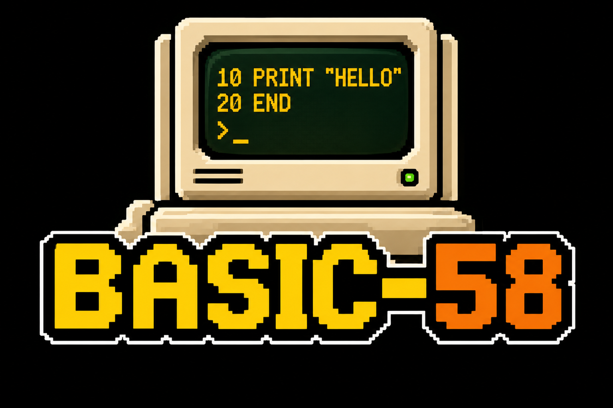

# BASIC-58

<p align="center">
  
</p>

**Version 1.0.0**

An experimental BASIC interpreter written in BASIC (B4X), inspired by retro computing.

---

## About BASIC-58

**BASIC-58** is a small, retro-inspired BASIC interpreter developed as a hobby project using [B4J](https://www.b4x.com/b4j.html).

The project was inspired by classic computers and projects such as MEGS65 and Xemu. Its purpose is to explore how a BASIC interpreter works internally, from parsing and evaluating expressions to managing program flow and handling runtime errors.

There is also a personal reason behind the project: BASIC-58 is intended to be shared with my grandchild as a way to discover programming, experiment with simple programs, and learn how computers execute instructions.

The familiar BASIC prompt, numbered program lines, and straightforward commands bring back some of the experience of programming on early personal computers.

### A little bit of retro irony

BASIC-58 is itself written in BASIC — specifically, B4J.

`So BASIC is being used to bring BASIC back.`

---

## Features

**BASIC-58** implements a practical subset of **classic BASIC**.

### Programming environment

- Interactive BASIC command prompt.
- Numbered program lines.
- Enter, replace, list, and delete program lines.
- Run BASIC programs.
- Immediate-mode commands and expressions.
- Create a new program.
- Save and load BASIC program files.
- Break program execution.
- Clear the output area.

### BASIC language

- Numeric and string variables.
- Arithmetic expressions and operator precedence.
- String expressions and functions.
- `LET` assignments.
- `INPUT` for interactive keyboard input.
- `ASSIGN` for external numeric data acquisition.
- `PRINT`.
- `IF ... THEN` conditional branching.
- `GOTO` and `GOSUB`.
- `RETURN`.
- `FOR ... TO ... STEP` and `NEXT`.
- `ON ... GOTO` and `ON ... GOSUB`.
- `DATA`, `READ`, and `RESTORE`.
- `RANDOMIZE` and `RND(1)`.
- `REM` comments.
- `END`.
- User-defined numeric functions (`DEF FN`).
- Multiple function parameters and nested function calls.
- Runtime error handling and recovery.
- Execution tracing (`TRACE ON` and `TRACE OFF`).
- Number base conversion (`HEX`, `BIN`, and `OCT`).
- Host application notifications using `@HOST STATE`.

### Error handling

- `ON ERROR GOTO`
- `ON ERROR GOTO 0`
- `RESUME`
- `RESUME NEXT`
- `ERR`
- `ERL`

---

## Screenshot

<p align="center">
  
</p>

---

## Requirements

- Windows
- Java runtime compatible with B4J
- B4J 64-bit for development
- B4XPages

The application is developed with B4J.

---

## Getting started

Start BASIC-58 to open the interactive command prompt.

You can enter commands directly or create a numbered BASIC program.

For example:

```basic
10 REM FIRST BASIC-58 PROGRAM
20 LET A = 10
30 LET B = 20
40 PRINT "HELLO FROM BASIC-58"
50 PRINT "THE SUM IS "; A + B
60 END
```

Enter:

```text
RUN
```

Expected output:

```text
HELLO FROM BASIC-58
THE SUM IS 30
```

---

## Command reference

The following commands are available in the BASIC-58 environment.

| Command | Description |
|---|---|
| `HELP` | Display help information. |
| `RUN` | Execute the current program. |
| `NEW` | Create a new empty program. |
| `SAVE` | Save the current BASIC program to a program file. |
| `LOAD` | Load a BASIC program from a program file. |
| `CLS` | Clear the output area. |
| `BREAK` | Interrupt program execution. |
| `BYE` | Close BASIC-58 and return to the desktop. |
| `LIST` | List the entire program. |
| `LIST start-line` | List from the specified line onwards. |
| `LIST start-line, end-line` | List the specified line range, inclusive. |
| `RENUM` | Renumber the program, starting at line 10 in increments of 10. |
| `RENUM new-start` | Renumber the program from the specified starting line, using increments of 10. |
| `RENUM new-start, increment` | Renumber the program using the specified starting line and increment. |

### Immediate expressions

These can also be evaluated directly:

```basic
PRINT 10 + 20
PRINT "HELLO"
```

### RENUM

Renumbers the current program.

Line references in `GOTO`, `GOSUB` and `IF ... THEN` statements are updated automatically.

Examples:

```basic
RENUM
RENUM 100
RENUM 100,5
```

Numeric and string data are supported.

> RENUM sorts program lines by their existing line numbers before assigning new sequential line numbers. Execution order is therefore determined by line numbers, not by the order in which lines were entered.

---

### Editing program lines

BASIC programs use numbered lines.

Entering a line number with new code inserts or replaces that line:

```basic
10 PRINT "HELLO"
20 PRINT "WORLD"
```

Entering a line number without code deletes the corresponding line:

```basic
20
```

The program can be displayed with `LIST`.

LIST options:

```text
LIST
LIST 100
LIST 100,200
```

---

## Saving and loading programs

BASIC-58 supports saving and loading BASIC program files.

Use:

```text
SAVE
```

to save the current program.

Use:

```text
LOAD
```

to load a previously saved program.

The editor tracks modifications so that unsaved changes can be identified. When an operation would discard modified source code, BASIC-58 asks for confirmation.

---

## Program line numbering

BASIC-58 supports both numbered and unnumbered program lines.

When a program is loaded from the editor, lines without an explicit line number are automatically numbered, starting at 10 and increasing in steps of 10.

For example, entering:

```basic
LET A = 1
PRINT A
END
```

is interpreted as:

```basic
10 LET A = 1
20 PRINT A
30 END
```

Explicit line numbers are preserved. Program lines are stored and listed in ascending line-number order.

Use the `RENUM` command to renumber the entire program.

---

## BASIC-58 language reference

### Variables

BASIC-58 supports numeric and string variables.

Numeric variables can use descriptive names.

String variable names end with a dollar sign (`$`).

Examples:

```basic
10 LET TOTAL = 100
20 LET NAME$ = "BASIC-58"
30 PRINT TOTAL
40 PRINT NAME$
```

String variables use a trailing dollar sign:

```basic
10 LET A$ = "BASIC-58"
20 PRINT A$
```

### Important assignment rule

Ordinary variable assignments require the `LET` keyword.

Correct:

```basic
10 LET A = 10
20 LET B = A * 2
```

Incorrect:

```basic
10 A = 10
20 B = A * 2
```

`FOR` loop initialization and `READ` assignments are exceptions and do not require `LET`.

---

### Arithmetic operators

| Operator | Description |
|---|---|
| `+` | Addition |
| `-` | Subtraction |
| `*` | Multiplication |
| `/` | Division |

Parentheses can be used to control evaluation order.

BASIC-58 evaluates arithmetic expressions using operator precedence.

Example:

```basic
10 LET A = 10 + 5 * 2
20 LET B = (10 + 5) * 2
30 PRINT A
40 PRINT B
```

Expected output:

```text
20
30
```

---

### Program control

| Statement | Description |
|---|---|
| `IF ... THEN` | Conditional branch |
| `GOTO` | Jump to a program line |
| `GOSUB` | Call a subroutine |
| `RETURN` | Return from a subroutine |
| `FOR` | Start a counted loop |
| `NEXT` | Continue or finish a loop |
| `ON ... GOTO` | Select a branch |
| `ON ... GOSUB` | Select a subroutine |
| `END` | End program execution |

---

### Execution tracing

BASIC-58 provides simple execution tracing to help debug programs.

Two statements control tracing:

| Statement | Description |
|---|---|
| `TRACE ON` | Enable execution tracing |
| `TRACE OFF` | Disable execution tracing |

While tracing is enabled, BASIC-58 displays the line number of each executed program statement using the `[TRACE]` prefix.

Example:

```basic
10 TRACE ON
20 FOR I = 1 TO 3
30 PRINT I
40 NEXT I
50 TRACE OFF
60 END
```

Example output:

```text
[TRACE] 20
[TRACE] 30
1
[TRACE] 40
[TRACE] 30
2
[TRACE] 40
[TRACE] 30
3
[TRACE] 40
[TRACE] 50
```

Repeated execution of a line, such as during a FOR/NEXT loop, is displayed each time.

---

### Important IF ... THEN rule

In BASIC-58, `IF ... THEN` accepts a line number as its target. It does not accept an inline statement.

Correct:

```basic
10 IF A > 10 THEN 100
```

Incorrect:

```basic
10 IF A > 10 THEN GOTO 100
20 IF A > 10 THEN LET B = 5
30 IF A > 10 THEN PRINT A
```

Use separate program lines for conditional actions:

```basic
10 IF A < B THEN 50
20 GOTO 60
50 LET A = B
60 PRINT A
```

Supported comparison operators:

| Operator | Description |
|---|---|
| `=` | Equal |
| `<>` | Not equal |
| `<` | Less than |
| `>` | Greater than |
| `<=` | Less than or equal |
| `>=` | Greater than or equal |

---

### FOR / NEXT loops

BASIC-58 supports counted loops, including nested loops and positive or negative step values.

```basic
10 FOR I = 1 TO 5
20 PRINT I
30 NEXT I
40 END
```

A step value can be specified:

```basic
10 FOR I = 10 TO 0 STEP -2
20 PRINT I
30 NEXT I
40 END
```

Loop variables must be single letters from A to Z.

---

### INPUT, ASSIGN and PRINT

`INPUT` reads values from the user.

```basic
10 INPUT "WHAT IS YOUR NAME? "; NAME$
20 PRINT "HELLO "; NAME$
30 END
```

Multiple input variables and comma-separated values are supported.

`PRINT` displays numeric and string expressions.

`PRINT` supports the following formatting options:

| Feature | Description |
|---|---|
| `;` | Separates expressions without inserting spacing. |
| `,` | Advances output to the next print zone. |
| `TAB(n)` | Positions output at the specified column. |
| `SPC(n)` | Inserts the specified number of spaces. |

A trailing semicolon or comma suppresses the automatic newline at the end of a PRINT statement.

Example:

```basic
10 LET A = 10
20 LET B = 20
30 PRINT "A = "; A
40 PRINT "B = "; B
50 PRINT "SUM = "; A + B
60 PRINT "VALUE"; TAB(20); "RESULT"
70 PRINT "TOTAL"; SPC(5); A + B
80 END
```

**Important — PRINT separator (`;`)**

The semicolon separates output items but does not insert a space automatically.

If a space is required between text and the following value, include it explicitly in the text.

Example:

```basic
10 LET SAVED = 100
20 PRINT "YOU HAVE SAVED "; SAVED
```

Output:

```text
YOU HAVE SAVED 100
```

#### ASSIGN — external numeric data

`ASSIGN` receives numeric data from an external device through the serial interface.

Unlike `INPUT`, which waits for keyboard input, `ASSIGN` waits for the next incoming external numeric value.

Values can be assigned to numeric variables or existing numeric array elements.

Example:

```basic
10 @SER CONNECT COM10
20 DIM TEMP(5)
30 FOR I = 1 TO 5
40 ASSIGN TEMP(I)
50 PRINT "TEMPERATURE: "; TEMP(I)
60 NEXT I
70 @SER DISCONNECT
80 END
```

A value received through `ASSIGN` becomes a normal BASIC-58 numeric variable value. A host application can retrieve that value using the `GetVariable` host API. When execution is asynchronous, the host should retrieve the value after the interpreter signals that the program has finished.

If the serial connection is lost while ASSIGN is waiting, program execution stops with:

```text
?SERIAL CONNECTION LOST
```

The `BREAK` command cancels a pending `ASSIGN` and stops program execution.

---

### DATA, READ and RESTORE

`DATA` defines values in a program.

`READ` assigns those values to variables.

`RESTORE` resets the DATA read position.

```basic
10 DATA 10,20,30,40,50
20 FOR I = 1 TO 5
30 READ A
40 PRINT A
50 NEXT I
60 RESTORE
70 READ B
80 PRINT "FIRST VALUE AGAIN: "; B
90 END
```

---

## Arrays

BASIC-58 supports one-dimensional numeric arrays.

Arrays must be declared using `DIM` before they can be used.

Array indices start at 1.

Example:

```basic
10 DIM TEMPERATURE(10)
20 LET TEMPERATURE(1) = 21.5
30 LET TEMPERATURE(2) = 22.0
40 PRINT TEMPERATURE(1)
50 PRINT UBOUND(TEMPERATURE)
60 END
```

Array commands and functions:

- `DIM array(size)` declares an array.
- `ERASE array` removes an array from memory.
- `UBOUND(array)` returns the highest valid array index.
- `SWAP variable1, variable2` exchanges two numeric values.

`SWAP` supports numeric variables, array elements, and combinations of numeric variables and array elements.

Arrays are initialized with zero values when declared.

---

### Random numbers

BASIC-58 supports `RANDOMIZE` and `RND(1)`.

Example:

```basic
10 RANDOMIZE
20 LET DICE = INT(RND(1) * 6) + 1
30 PRINT "DICE: "; DICE
40 END
```

---

### User-defined functions

BASIC-58 supports user-defined numeric functions using `DEF FN`.

Functions can have one or more parameters and return the result of a numeric expression.

Example:

```basic
10 DEF FN DOUBLE(X) = X * 2
20 DEF FN ADD(X,Y) = X + Y
30 PRINT FN DOUBLE(21)
40 PRINT FN ADD(12,30)
50 END
```

Expected output:

```text
42
42
```

Functions can call other user-defined functions, allowing nested function expressions.

A function must be defined before it is called during program execution. Defining an existing function again replaces its previous definition.

---

## Mathematical functions

BASIC-58 provides the following numeric functions.

| Function | Description |
|---|---|
| `ABS(x)` | Absolute value |
| `COS(x)` | Cosine |
| `DIV(a,b)` | Returns the integer quotient after division |
| `EXP(x)` | Exponential |
| `INT(x)` | Integer part |
| `LOG(x)` | Natural logarithm |
| `MAX(n,m)` | Return the larger of two numbers | 
| `MIN(n,m)` | Return the smaller of two numbers | 
| `MOD(a,b)` | Returns the remainder after integer division |
| `RND(1)`     | Random number |
| `ROUND(n)`   | Round to the nearest integer |
| `ROUND(n,m)` | Round to m decimal places; negative m rounds to tens, hundreds, etc. |
| `SGN(x)` | Sign of a number |
| `SIN(x)` | Sine |
| `SQR(x)` | Square root |
| `TAN(x)` | Tangent |

Trigonometric functions use radians.

---

## String functions

BASIC-58 provides the following string functions.

| Function | Description |
|---|---|
| `LEN(s$)` | String length |
| `LEFT$(s$,n)` | Leftmost characters |
| `RIGHT$(s$,n)` | Rightmost characters |
| `MID$(s$,start,n)` | Extract part of a string |
| `INSTR(s$,sub$)` | Find a substring |
| `STR$(x)` | Convert a number to a string |
| `VAL(s$)` | Convert a string to a number |
| `ASC(s$)` | Character code |
| `CHR$(n)` | Character from a code |
| `SPACE$(n)` | String containing spaces |
| `STRING$(n,c)` | Repeated character string |
| `UCASE$(s$)` | Convert to uppercase |
| `LCASE$(s$)` | Convert to lowercase |
| `LTRIM$(s$)` | Remove leading spaces |
| `RTRIM$(s$)` | Remove trailing spaces |
| `TRIM$(s$)` | Remove leading and trailing spaces |
| `HEX(x)` | Convert an integer to a hexadecimal string |
| `BIN(x)` | Convert an integer to a binary string |
| `OCT(x)` | Convert an integer to an octal string |

### Number base conversion

BASIC-58 supports conversion of integer values to hexadecimal, binary and octal strings.

Example:

```basic
10 LET VALUE = 1958
20 PRINT "DECIMAL: "; VALUE
30 PRINT "HEX: "; HEX(VALUE)
40 PRINT "BINARY: "; BIN(VALUE)
50 PRINT "OCTAL: "; OCT(VALUE)
60 END
```

The functions return strings and can be used directly in PRINT statements and string expressions.

---

## Error handling

BASIC-58 supports BASIC-style error handling.

The following statements and functions are available:

| Statement / Function | Description |
|---|---|
| `ON ERROR GOTO` | Enable an error handler |
| `ON ERROR GOTO 0` | Disable the error handler |
| `RESUME` | Resume execution at the failing statement |
| `RESUME NEXT` | Resume at the following statement |
| `ERR` | Current error code |
| `ERL` | Line number where the error occurred |

Example:

```basic
10 ON ERROR GOTO 100
20 LET A = 10
30 LET B = 0
40 LET C = A / B
50 PRINT C
60 END
100 PRINT "ERROR "; ERR
110 PRINT "IN LINE "; ERL
120 END
```

BASIC-58 reports runtime errors and provides a way to recover or continue program execution.

---

## System commands

BASIC-58 provides commands for accessing basic host system information and controlling program execution.

### System information

Display the current system time and date:

```text
@SYS SHOW TIME
@SYS SHOW DATE
```

### Settings

Display current application settings:

```text
@SYS SHOW SETTINGS
```
Set and save the BASIC program directory:

```text
@SYS SET FILEDIR "path"
```
The directory must already exist. The setting is stored in `basic58.set` and restored automatically at startup.
Example:

```text
@SYS SHOW SETTINGS
@SYS SET FILEDIR "D:\BASIC58\Programs"
```

```text
@SYS SET RUNCLEAR ON
```text
Clear the terminal automatically when RUN starts
```text
@SYS SET RUNCLEAR OFF
```
Keep existing terminal output when RUN starts

### Execution delay

```text
@DELAY milliseconds
```

Pause program execution asynchronously for the specified number of milliseconds.

The asynchronous implementation allows the application to remain responsive during the delay.

---

## Host application integration

BASIC-58 can be embedded in a host application. The host can supply numeric values, run BASIC-58 program logic, retrieve calculated values, and receive state-change notifications.

The host integration is deliberately separate from the BASIC-58 language and does not tie the interpreter to a particular external protocol.

### Host bridge commands and methods

| Interface | Direction | Purpose |
|---|---|---|
| `SetVariable(Name, Value)` | Host → BASIC-58 | Supply a numeric value before execution. |
| `GetVariable(Name)` | Host ← BASIC-58 | Retrieve the current value of a BASIC-58 numeric variable. |
| `@HOST STATE "NAME" VALUE` | BASIC-58 → Host | Send a state-change notification to the host. |

Host-supplied variables are copied into the normal BASIC-58 variable map when `RUN` starts. Calling `SetVariable` while a program is already executing does not immediately update its active variable; the new value is available at the next `RUN`.

`GetVariable` returns the current value of a numeric variable, or zero if the variable does not exist.

### @HOST STATE

Syntax:

```basic
@HOST STATE "NAME" VALUE
```

- `NAME` is a state name enclosed in quotation marks.
- `VALUE` is a numeric value or numeric expression.

Example:

```basic
100 @HOST STATE "PUMP" 1
110 @HOST STATE "ALARM" 0
```

When BASIC-58 executes this command, it raises the `HostStateChanged` callback in the host application. The host receives the state name and numeric value and decides what action to perform.

For example, the host could switch a hardware output, write an OPC UA variable, publish an MQTT message, send a command to an Arduino, update an application indicator, or record an event.

**Important:** `@HOST STATE` sends a notification only. It does not directly control hardware. Changing a BASIC-58 variable does not automatically generate a host notification.

### Example: host-controlled tank level logic

The host supplies a tank level, and BASIC-58 evaluates it:

```basic
10 PRINT "TANK LEVEL CONTROL"
20 PRINT "LEVEL: "; LEVEL; " %"
30 IF LEVEL < 30 THEN 100
40 IF LEVEL > 80 THEN 200
50 END
100 PRINT "LOW LEVEL - START PUMP"
110 @HOST STATE "PUMP" 1
120 END
200 PRINT "HIGH LEVEL - STOP PUMP"
210 @HOST STATE "PUMP" 0
220 END
```

The host might supply the input with:

```vb
Interpreter.SetVariable("LEVEL", 20)
```

After execution, the host can retrieve the value using:

```vb
Dim Level As Double = Interpreter.GetVariable("LEVEL")
```

The host implements the `HostStateChanged` callback to receive the pump request.

For the complete B4J API, callback implementation, communication flow, and tested host examples, see **[BASIC-58 Host Bridge](Documentation/BASIC58_Host_Bridge_README.md)**.

---

## Serial communication and hardware control

BASIC-58 includes a serial communication interface that allows BASIC programs to interact with external hardware.

The communication is based on a compact, fixed-length **five-byte binary protocol**. Its simple structure makes it possible to communicate with different devices and microcontrollers without requiring a complex communication stack.

### Serial commands

```text
@SER CONNECT COMx
@SER DISCONNECT
@SER LISTPORTS
@SER ADR CMD VAL
```

- `ADR` — Device address (0–255)
- `CMD` — Command code (0–255)
- `VAL` — Command value (0–255)

All three parameters accept numeric literals, numeric variables or parenthesized numeric expressions.

The command is transmitted using the BASIC-58 five-byte serial protocol:

```text
0x19 | ADR | CMD | VAL | 0x58
```

Example:

```basic
10 @SER CONNECT COM10
20 @SER 18 4 1
30 @DELAY 1000
40 @SER 18 4 0
50 @SER DISCONNECT
```

Or using variables and expressions:

```basic
10 @SER CONNECT COM10
20 LET LED = 18
30 LET CMD = 4
40 LET STATE = 1
50 @SER LED CMD STATE
60 @SER LED (2 + 2) STATE
70 @SER DISCONNECT
80 END
```

Exactly three parameters are required.

Expressions containing spaces must be enclosed in parentheses.

Each parameter must evaluate to an integer between 0 and 255.

The serial transport and protocol remain independent of the meaning of individual commands. The connected controller determines how each command is interpreted.

These commands provide serial connection management and basic hardware control.

### External data acquisition

BASIC-58 can receive numeric values from external devices using the `ASSIGN` statement.

Two forms are supported.

#### Single-value assignment

```basic
ASSIGN variable
```

Waits for the next incoming serial frame and assigns its `VAL` field to a numeric variable or an existing numeric array element.

Example:

```basic
10 @SER CONNECT COM10
20 DIM TEMPERATURE(10)
30 FOR I = 1 TO 10
40 ASSIGN TEMPERATURE(I)
50 PRINT "TEMPERATURE: "; TEMPERATURE(I)
60 NEXT I
70 @SER DISCONNECT
80 END
```

This example collects ten temperature readings and calculates their average:

```basic
10 @SER CONNECT COM10
20 DIM TEMPERATURE(10)
30 FOR I = 1 TO 10
40 ASSIGN TEMPERATURE(I)
50 NEXT I
60 LET TOTAL = 0
70 FOR I = 1 TO 10
80 LET TOTAL = TOTAL + TEMPERATURE(I)
90 NEXT I
100 PRINT "AVERAGE: "; TOTAL / 10
110 @SER DISCONNECT
120 END
```

#### Three-field assignment

```basic
ASSIGN ADR,CMD,VAL
```

Waits for the next incoming serial frame and assigns all three fields to numeric variables:

- `ADR` — Device address
- `CMD` — Command code
- `VAL` — Command value

Example:

```basic
10 @SER CONNECT COM10
20 PRINT "WAITING FOR TEMPERATURE..."
30 ASSIGN ADR,CMD,VAL
40 IF ADR = 32 THEN 60
50 GOTO 30
60 IF CMD = 1 THEN 80
70 GOTO 30
80 PRINT "TEMPERATURE: "; VAL
90 GOTO 30
```

This example accepts only frames with address 32 and command 1. Other frames are ignored, and the program waits for the next incoming frame.

`ASSIGN` does not accept string variables.

If the serial connection is lost while waiting for external data, BASIC-58 reports:

```text
?SERIAL CONNECTION LOST
```

and stops program execution.

The `BREAK` command cancels a pending `ASSIGN` and stops program execution.

A received value is stored as a normal BASIC-58 numeric variable. A host application can retrieve it through `GetVariable` after the interpreter signals that execution has completed.

### Communication protocol

The protocol uses five bytes per message:

| Byte | Description |
|---|---|
| 1 | Header |
| 2 | Device address |
| 3 | Command |
| 4 | Value |
| 5 | Footer |

Communication is bi-directional. BASIC-58 can send commands to an external device and receive responses or acknowledgements.

The protocol is deliberately kept simple and compact. It is not restricted to a specific microcontroller or programming language. Any device implementing the same protocol can communicate with BASIC-58.

### Current implementation

Serial communication has been implemented and tested with a microcontroller running B4R firmware.

The B4J application handles the serial connection, message framing, acknowledgement handling and communication timeouts.

The serial interface is intended to be developed further.

Planned areas include:

- Testing communication with standard Python scripts.
- Testing communication with MicroPython on supported microcontrollers.
- Extending the protocol commands and hardware control capabilities.
- Exploring additional applications for small automation and maker projects.

This opens up interesting possibilities for BASIC-58. For example, BASIC programs could control LEDs, read sensor values, operate small mechanisms or interact with custom electronic projects.

The aim is to make BASIC-58 not only a retro-inspired programming environment, but also a simple platform for experimenting with hardware and physical computing.

> **BASIC-58 is more than a retro-inspired BASIC interpreter. It is a small programming environment that can reach beyond the computer screen and control real hardware.**

---

## Example programs

BASIC-58 includes a collection of example programs demonstrating the language features and practical capabilities of the interpreter.

These examples cover arithmetic, variables, loops, conditional branching, input, output, mathematical functions, string handling, and DATA processing.

The examples are organized into folders.

### 00_GETSTARTED

Ten small BASIC-58 programs for young beginners (around age 10).

The examples are arranged as a gentle progression. Run them, try them, and then change the programs to see what happens.

#### The ten examples

| File | Program | What it introduces |
|---|---|---|
| `01_HELLO.BAS` | Hello | `PRINT`, text input and string variables |
| `02_MY_AGE.BAS` | My age in ten years | Numeric input, variables and arithmetic |
| `03_ROCKET.BAS` | Rocket countdown | `FOR` / `NEXT` loops and negative steps |
| `04_TIMES_TABLE.BAS` | Multiplication challenge | Random numbers, multiplication and `IF` |
| `05_GUESS_NUMBER.BAS` | Guess my number | Random numbers, comparisons, branching and attempts |
| `06_DICE_ROLLS.BAS` | Ten dice rolls | Loops, random numbers and counting |
| `07_MINI_CALCULATOR.BAS` | Mini calculator | Choices, arithmetic and branching |
| `08_TREASURE_HUNT.BAS` | Treasure hunt | Coordinates, comparisons and hints |
| `09_SAVING_GOAL.BAS` | Saving goal | Repeated calculations and a loop |
| `10_ROCK_PAPER_SCISSORS.BAS` | Rock, Paper, Scissors | Random choices and game rules |

#### How to use

1. Open BASIC-58.
2. Load one of the `.BAS` files from this folder.
3. Run the program.
4. Try changing the program and run it again.

### 01_LANGUAGE

Demonstrations of BASIC language features, including:

- Arithmetic and expressions
- INPUT and PRINT
- Conditional statements
- FOR/NEXT loops and nested loops
- GOSUB/RETURN and ON GOTO/ON GOSUB
- Numeric and string functions
- DATA, READ and RESTORE
- Random numbers
- Error handling and recovery
- Program saving and loading

### 02_PRACTICAL

Complete programs covering mathematical problems and everyday calculations, including:

- Temperature conversion
- Compound interest
- Grade averages
- Prime numbers
- Pythagorean triples
- Unit conversion
- Electricity costs
- Square root tables
- Loan and mortgage calculations
- Statistics
- Savings plans
- Fibonacci numbers and factorials

### 03_GAMES

Interactive programs demonstrating BASIC-58 in a playful way:

- Dice game
- Number guessing game

### 04_HARDWARE

Demonstrations of serial communication:

- LED blink
- LED SOS

### 99_DEVELOPMENT

Additional programs used during development, debugging and regression testing of the BASIC-58 interpreter.

---

## A few BASIC-58 reminders

- BASIC statements are numbered.
- Use `LET` for assignments, for example `LET TOTAL = A + B`.
- `IF` branches to a line number, for example `IF ANSWER = 42 THEN 100`.
- `FOR` and `NEXT` repeat a group of lines.
- `RND(1)` produces a random value; these examples use `INT(RND(1) * N) + 1` to produce an integer from 1 through N.
- `INPUT` asks the player to enter a value.
- Variable names: maximum 8 characters.
- FOR loop variables: single letters only.
- When joining text and a value with `;` in a `PRINT` statement, include a trailing space in the text if you want a space in the output. For example: `PRINT "SAVED "; SAVED`.

---

## Testing

BASIC-58 has been tested incrementally during development.

### Application acceptance tests

The following application areas have been checked:

1. Startup and user interface.
2. Editor and immediate commands.
3. NEW command and editor behavior.
4. SAVE and LOAD operations.
5. Error handling and recovery.
6. Keyboard shortcuts and application lifecycle.

All six acceptance test groups passed.

### BASIC program regression tests

A growing collection of BASIC programs has been developed and tested, covering language features, practical calculations, mathematical problems and interactive games.

Additional language tests cover:

- Numeric and string expressions.
- Mathematical and string functions.
- Number base conversion (`HEX`, `BIN`, and `OCT`).
- Execution tracing (`TRACE ON` and `TRACE OFF`).
- Conditional branching.
- Nested FOR/NEXT loops.
- GOTO and GOSUB.
- ON GOTO and ON GOSUB.
- DATA, READ and RESTORE.
- INPUT validation.
- Runtime errors and recovery.
- User-defined numeric functions.
- Multiple function parameters.
- Nested function calls.
- Function parameter isolation.
- Function definition and redefinition.
- Function argument and expression error handling.
- External serial data acquisition using `ASSIGN`.
- `ASSIGN` with numeric array elements.
- Serial disconnection handling during data acquisition.
- Host-supplied numeric variables and retrieval through the host bridge.
- BASIC-58 to host state notifications using `@HOST STATE`.
- Serial temperature acquisition and host retrieval of the received value.

---

## Project status

**BASIC-58** is a working hobby project and a learning exercise in interpreter development.

The current release represents a tested and usable implementation of its BASIC language subset.

The project is intentionally kept small and approachable. It is not intended to be a complete implementation of any particular historical BASIC dialect.

---

## BASIC-58 and classic BASIC

BASIC-58 is inspired by traditional, line-numbered BASIC dialects such as Microsoft GW-BASIC. It is not intended to be a complete implementation of GW-BASIC or any other historical BASIC dialect.

It keeps the familiar BASIC programming style while providing a smaller, simpler language with extensions for serial communication and system control.

### Similarities

| Feature | BASIC-58 | Classic GW-BASIC |
|---|---|---|
| Numbered program lines | Yes | Yes |
| Numeric variables | Yes | Yes |
| LET assignments | Yes, required | Yes, optional |
| PRINT | Yes | Yes |
| INPUT | Yes | Yes |
| IF ... THEN line branching | Yes | Yes |
| FOR ... TO ... STEP ... NEXT | Yes | Yes |
| Nested FOR loops | Supported | Supported |
| Random numbers | RND(1) | RND |
| Integer conversion | INT() | INT() |
| Numeric expressions | Yes | Yes |
| Numeric arrays | Yes | Yes |

### Differences and restrictions

| Feature | BASIC-58 | Classic GW-BASIC |
|---|---|---|
| LET | Required for assignments | Optional |
| Variable names | Maximum 8 characters | Longer names allowed |
| FOR loop variables | Single letters only | Normal numeric variables |
| IF ... THEN | Branches to a line number | Can also execute statements |
| PRINT separator | Semicolon does not insert spaces | Semicolon does not insert spaces |
| Language scope | Deliberately limited | Much larger language |
| Hardware communication | Built-in serial commands | Different, device-dependent mechanisms |

### BASIC-58 extensions

BASIC-58 adds features that are not part of the traditional GW-BASIC language:

| Feature | Purpose |
|---|---|
| `ASSIGN` | Assign externally received numeric data to BASIC variables |
| `HEX()` | Convert a number to a hexadecimal string |
| `BIN()` | Convert a number to a binary string |
| `OCT()` | Convert a number to an octal string |
| `@SER` | Send serial commands |
| `@DELAY` | Pause program execution asynchronously |
| `@HOST STATE` | Send state-change notifications to the host application |
| `@SYS SHOW TIME` | Display the current time |
| `@SYS SHOW DATE` | Display the current date |
| `@SYS SHOW VERSION` | Display BASIC-58 version information |
| `@SYS SHOW SETTINGS` | Display application settings |
| `@SYS SET FILEDIR` | Change the program directory |

### Design philosophy

BASIC-58 is a hobby project with an educational purpose.

It does not aim to reproduce every feature of a historical BASIC interpreter. Instead, it focuses on a manageable set of BASIC statements, expressions and functions, combined with practical extensions for communication with external hardware and host applications.

The goal is simplicity, readability and experimentation.

**Small enough to understand, powerful enough to be useful, and fun to program!**

A few important distinctions:

- GW-BASIC allows `A = 10` without LET; BASIC-58 deliberately requires LET.
- GW-BASIC allows multi-character FOR variables; BASIC-58 currently restricts them to single letters.
- GW-BASIC supports executable statements after THEN; BASIC-58 uses line-number branching.
- GW-BASIC uses functions such as `HEX$()` and `OCT$()`, whereas BASIC-58 uses `HEX()`, `BIN()` and `OCT()`.

These differences are supported by the historical GW-BASIC reference documentation.

The table describes the features established so far. It will be rechecked against the actual interpreter source as BASIC-58 statements and functions are extended.

---

## License

This project is licensed under the MIT License.

See the [LICENSE](LICENSE) file for details.

---

## Credits, Acknowledgements and Inspiration

- [Anywhere Software](https://www.b4x.com/) for the B4X suite of RAD development tools.
- [MEGS65](https://github.com/MEGS65) and [Xemu](https://github.com/theretroweb/xemu) for inspiration from the retro-computing community.
- [OpenAI](https://openai.com/) and ChatGPT for AI-assisted engineering collaboration, problem solving and development discussions.
- The wider programming and open-source communities for sharing knowledge, ideas and experience.

---

## Disclaimer

**BASIC-58** is an experimental hobby project developed for educational and learning purposes.

- The software is provided "AS IS", without warranty of any kind.
- It is not intended for professional, commercial, safety-critical or industrial control applications.
- It has not been designed, tested or certified for use in critical or production environments.
- Use of the software is entirely at your own risk.

All product names, logos, trademarks and brands mentioned in this project are the property of their respective owners.

---

> *BASIC-58 — Made with curiosity, a little nostalgia, and the conviction that BASIC still has something to teach us.*

---
