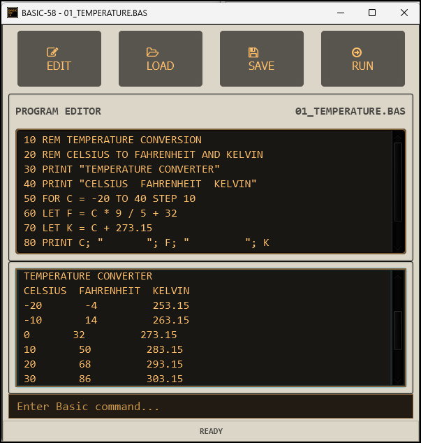

# BASIC-58

<p align="center">
  
</p>

**Version 1.0.0**

An experimental BASIC interpreter written in BASIC (B4X), inspired by retro computing.

---

## About BASIC-58

**BASIC-58** is a small, retro-inspired BASIC interpreter developed as a hobby project using [B4J](https://www.b4x.com/b4j.html).

The project was inspired by classic computers and projects such as MEGS65 and Xemu. Its purpose is to explore how a BASIC interpreter works internally, from parsing and evaluating expressions to managing program flow and handling runtime errors.

There is also a personal reason behind the project: BASIC-58 is intended to be shared with my grandchild as a way to discover programming, experiment with simple programs, and learn how computers execute instructions.

The familiar BASIC prompt, numbered program lines, and straightforward commands bring back some of the experience of programming on early personal computers.

### A little bit of retro irony

BASIC-58 is itself written in BASIC — specifically, B4J.

`So BASIC is being used to bring BASIC back.`

---

## Features

**BASIC-58** implements a practical subset of **classic BASIC**.

### Programming environment

- Interactive BASIC command prompt.
- Numbered program lines.
- Enter, replace, list, and delete program lines.
- Run BASIC programs.
- Immediate-mode commands and expressions.
- Create a new program.
- Save and load BASIC program files.
- Break program execution.
- Clear the output area.

### BASIC language

- Numeric and string variables.
- Arithmetic expressions and operator precedence.
- String expressions and functions.
- `LET` assignments.
- `INPUT` and `PRINT`.
- `IF ... THEN` conditional branching.
- `GOTO` and `GOSUB`.
- `RETURN`.
- `FOR ... TO ... STEP` and `NEXT`.
- `ON ... GOTO` and `ON ... GOSUB`.
- `DATA`, `READ`, and `RESTORE`.
- `RANDOMIZE` and `RND(1)`.
- `REM` comments.
- `END`.
- User-defined numeric functions (`DEF FN`).
- Multiple function parameters and nested function calls.- Runtime error handling and recovery.

### Error handling

- `ON ERROR GOTO`
- `ON ERROR GOTO 0`
- `RESUME`
- `RESUME NEXT`
- `ERR`
- `ERL`

---

## Screenshot

<p align="center">
  
</p>

---

## Requirements

- Windows
- Java runtime compatible with B4J
- B4J 64-bit for development
- B4XPages

The application is developed with B4J.

---

## Getting started

Start BASIC-58 to open the interactive command prompt.

You can enter commands directly or create a numbered BASIC program.

For example:

```basic
10 REM FIRST BASIC-58 PROGRAM
20 LET A = 10
30 LET B = 20
40 PRINT "HELLO FROM BASIC-58"
50 PRINT "THE SUM IS "; A + B
60 END
```

Enter:

```text
RUN
```

Expected output:

```text
HELLO FROM BASIC-58
THE SUM IS 30
```

---

## Command reference

The following commands are available in the BASIC-58 environment.

| Command | Description |
|---|---|
| `HELP` | Display help information. |
| `RUN` | Execute the current program. |
| `NEW` | Create a new empty program. |
| `SAVE` | Save the current BASIC program to a program file. |
| `LOAD` | Load a BASIC program from a program file. |
| `CLS` | Clear the output area. |
| `BREAK` | Interrupt program execution. |
| `BYE` | Close BASIC-58 and return to the desktop. |
| `LIST` | List the entire program. |
| `LIST start-line` | List from the specified line onwards. |
| `LIST start-line, end-line` | List the specified line range, inclusive. |
| `RENUM` | Renumber the program, starting at line 10 in increments of 10. |
| `RENUM new-start` | Renumber the program from the specified starting line, using increments of 10. |
| `RENUM new-start, increment` | Renumber the program using the specified starting line and increment. |

Immediate expressions can also be evaluated directly:

```basic
PRINT 10 + 20
PRINT "HELLO"
```

---

### Editing program lines

BASIC programs use numbered lines.

Entering a line number with new code inserts or replaces that line:

```basic
10 PRINT "HELLO"
20 PRINT "WORLD"
```

Entering a line number without code deletes the corresponding line:

```basic
20
```

The program can be displayed with `LIST`.
LIST Options:
```
LIST
LIST 100
LIST 100,200
```

---

## Saving and loading programs

BASIC-58 supports saving and loading BASIC program files.

Use:

```text
SAVE
```

to save the current program.

Use:

```text
LOAD
```

to load a previously saved program.

The editor tracks modifications so that unsaved changes can be identified. When an operation would discard modified source code, BASIC-58 asks for confirmation.

---

## Program line numbering

BASIC-58 supports both numbered and unnumbered program lines.

When a program is loaded from the editor, lines without an explicit
line number are automatically numbered, starting at 10 and
increasing in steps of 10.

For example, entering:

```basic
LET A = 1
PRINT A
END
```

is interpreted as:
```
10 LET A = 1
20 PRINT A
30 END
```

Explicit line numbers are preserved. Program lines are stored and
listed in ascending line-number order.

Use the RENUM command to renumber the entire program.

---

## BASIC-58 language reference

### Variables

BASIC-58 supports numeric and string variables.

Numeric variables can use descriptive names.

String variable names end with a dollar sign (`$`).

Examples:

```basic
10 LET TOTAL = 100
20 LET NAME$ = "BASIC-58"
30 PRINT TOTAL
40 PRINT NAME$
```

String variables use a trailing dollar sign:

```basic
10 LET A$ = "BASIC-58"
20 PRINT A$
```

### Important assignment rule

Ordinary variable assignments require the `LET` keyword.

Correct:

```basic
10 LET A = 10
20 LET B = A * 2
```

Incorrect:

```basic
10 A = 10
20 B = A * 2
```

`FOR` loop initialization and `READ` assignments are exceptions and do not require `LET`.

---

### Arithmetic operators

| Operator | Description |
|---|---|
| `+` | Addition |
| `-` | Subtraction |
| `*` | Multiplication |
| `/` | Division |

Parentheses can be used to control evaluation order.

BASIC-58 evaluates arithmetic expressions using operator precedence.

Example:

```basic
10 LET A = 10 + 5 * 2
20 LET B = (10 + 5) * 2
30 PRINT A
40 PRINT B
```

Expected output:

```text
20
30
```

---

### Program control

| Statement | Description |
|---|---|
| `IF ... THEN` | Conditional branch |
| `GOTO` | Jump to a program line |
| `GOSUB` | Call a subroutine |
| `RETURN` | Return from a subroutine |
| `FOR` | Start a counted loop |
| `NEXT` | Continue or finish a loop |
| `ON ... GOTO` | Select a branch |
| `ON ... GOSUB` | Select a subroutine |
| `END` | End program execution |

---

### Important IF ... THEN rule

In BASIC-58, `IF ... THEN` accepts a line number as its target. It does not accept an inline statement.

Correct:

```basic
10 IF A > 10 THEN 100
```

Incorrect:

```basic
10 IF A > 10 THEN GOTO 100
20 IF A > 10 THEN LET B = 5
30 IF A > 10 THEN PRINT A
```

Use separate program lines for conditional actions:

```basic
10 IF A < B THEN 50
20 GOTO 60
50 LET A = B
60 PRINT A
```

Supported comparison operators:

| Operator | Description |
|---|---|
| `=` | Equal |
| `<>` | Not equal |
| `<` | Less than |
| `>` | Greater than |
| `<=` | Less than or equal |
| `>=` | Greater than or equal |

---

### FOR / NEXT loops

BASIC-58 supports counted loops, including nested loops and positive or negative step values.

```basic
10 FOR I = 1 TO 5
20 PRINT I
30 NEXT I
40 END
```

A step value can be specified:

```basic
10 FOR I = 10 TO 0 STEP -2
20 PRINT I
30 NEXT I
40 END
```

Loop variables must be single letters from A to Z.

---

### INPUT and PRINT

`INPUT` reads values from the user.

```basic
10 INPUT "WHAT IS YOUR NAME? "; NAME$
20 PRINT "HELLO "; NAME$
30 END
```

Multiple input variables and comma-separated values are supported.

`PRINT` displays numeric and string expressions.

`PRINT` supports the following formatting options:
| Feature | Description |
|---|---|
| `;` | Separates expressions without inserting spacing. |
| `,` | Advances output to the next print zone. |
| `TAB(n)` | Positions output at the specified column. |
| `SPC(n)` | Inserts the specified number of spaces. |

A trailing semicolon or comma suppresses the automatic newline at the end of a PRINT statement.

Example:
```basic
10 LET A = 10
20 LET B = 20
30 PRINT "A = "; A
40 PRINT "B = "; B
50 PRINT "SUM = "; A + B
60 PRINT "VALUE"; TAB(20); "RESULT"
70 PRINT "TOTAL"; SPC(5); A + B
80 END
```

---

### DATA, READ and RESTORE

`DATA` defines values in a program.

`READ` assigns those values to variables.

`RESTORE` resets the DATA read position.

```basic
10 DATA 10,20,30,40,50
20 FOR I = 1 TO 5
30 READ A
40 PRINT A
50 NEXT I
60 RESTORE
70 READ B
80 PRINT "FIRST VALUE AGAIN: "; B
90 END
```

---

### RENUM

Renumbers the current program.

Line references in `GOTO`, `GOSUB` and `IF ... THEN` statements
are updated automatically.

Examples:

```basic
RENUM
RENUM 100
RENUM 100,5
```
Numeric and string data are supported.

---

### Random numbers

BASIC-58 supports `RANDOMIZE` and `RND(1)`.

Example:

```basic
10 RANDOMIZE
20 LET DICE = INT(RND(1) * 6) + 1
30 PRINT "DICE: "; DICE
40 END
```

---

### User-defined functions

BASIC-58 supports user-defined numeric functions using `DEF FN`.

Functions can have one or more parameters and return the result of a numeric expression.

Example:

```basic
10 DEF FN DOUBLE(X) = X * 2
20 DEF FN ADD(X,Y) = X + Y
30 PRINT FN DOUBLE(21)
40 PRINT FN ADD(12,30)
50 END
```
Expected Output:
```
42
42
```

Functions can call other user-defined functions, allowing nested function expressions.

A function must be defined before it is called during program execution. Defining an existing function again replaces its previous definition.

---

## Mathematical functions

BASIC-58 provides the following numeric functions.

| Function | Description |
|---|---|
| `INT(x)` | Integer part |
| `ABS(x)` | Absolute value |
| `SGN(x)` | Sign of a number |
| `SQR(x)` | Square root |
| `SIN(x)` | Sine |
| `COS(x)` | Cosine |
| `TAN(x)` | Tangent |
| `LOG(x)` | Natural logarithm |
| `EXP(x)` | Exponential |
| `RND(1)` | Random number |

Trigonometric functions use radians.

---

## String functions

BASIC-58 provides the following string functions.

| Function | Description |
|---|---|
| `LEN(s$)` | String length |
| `LEFT$(s$,n)` | Leftmost characters |
| `RIGHT$(s$,n)` | Rightmost characters |
| `MID$(s$,start,n)` | Extract part of a string |
| `INSTR(s$,sub$)` | Find a substring |
| `STR$(x)` | Convert a number to a string |
| `VAL(s$)` | Convert a string to a number |
| `ASC(s$)` | Character code |
| `CHR$(n)` | Character from a code |
| `SPACE$(n)` | String containing spaces |
| `STRING$(n,c)` | Repeated character string |
| `UCASE$(s$)` | Convert to uppercase |
| `LCASE$(s$)` | Convert to lowercase |
| `LTRIM$(s$)` | Remove leading spaces |
| `RTRIM$(s$)` | Remove trailing spaces |
| `TRIM$(s$)` | Remove leading and trailing spaces |

---

## Error handling

BASIC-58 supports BASIC-style error handling.

The following statements and functions are available:

| Statement / Function | Description |
|---|---|
| `ON ERROR GOTO` | Enable an error handler |
| `ON ERROR GOTO 0` | Disable the error handler |
| `RESUME` | Resume execution at the failing statement |
| `RESUME NEXT` | Resume at the following statement |
| `ERR` | Current error code |
| `ERL` | Line number where the error occurred |

Example:

```basic
10 ON ERROR GOTO 100
20 LET A = 10
30 LET B = 0
40 LET C = A / B
50 PRINT C
60 END
100 PRINT "ERROR "; ERR
110 PRINT "IN LINE "; ERL
120 END
```

BASIC-58 reports runtime errors and provides a way to recover or continue program execution.

---

## System commands

BASIC-58 provides commands for accessing basic host system information and controlling program execution.

### System information

#### Display the current system time and date.
```text
@SYS SHOW TIME
@SYS SHOW DATE
```

#### Execution delay
```
@DELAY milliseconds
```
Pause program execution asynchronously for the specified number of milliseconds.
The asynchronous implementation allows the application to remain responsive during the delay.

---

## Serial communication and hardware control

BASIC-58 includes a serial communication interface that allows BASIC programs to interact with external hardware.

The communication is based on a compact, fixed-length **five-byte binary protocol**.  
Its simple structure makes it possible to communicate with different devices and microcontrollers without requiring a complex communication stack.

### Serial commands

```text
@SER CONNECT COMx
@SER DISCONNECT
@SER LISTPORTS
@SER LED adr ON
@SER LED adr OFF
```markdown

These commands provide serial connection management and basic hardware control.

### Communication protocol
The protocol uses five bytes per message:
```markdown
Byte	Description
1	Header
2	Device address
3	Command
4	Value
5	Footer
```markdown

Communication is bi-directional. BASIC-58 can send commands to an external device and receive responses or acknowledgements.

The protocol is deliberately kept simple and compact. It is not restricted to a specific microcontroller or programming language.  
Any device implementing the same protocol can communicate with BASIC-58.

### Current implementation
Serial communication has been implemented and tested with a microcontroller running B4R firmware.

The B4J application handles the serial connection, message framing, acknowledgement handling and communication timeouts.
Further development
The serial interface is intended to be developed further.

Planned areas include:
- Testing communication with standard Python scripts.
- Testing communication with MicroPython on supported microcontrollers.
- Extending the protocol commands and hardware control capabilities.
- Exploring additional applications for small automation and maker projects.
This opens up interesting possibilities for BASIC-58. 
For example, BASIC programs could control LEDs, read sensor values, operate small mechanisms or interact with custom electronic projects.

The aim is to make BASIC-58 not only a retro-inspired programming environment, but also a simple platform for experimenting with hardware and physical computing.

> **BASIC-58 is more than a retro-inspired BASIC interpreter. It is a small programming environment that can reach beyond the computer screen and control real hardware.**

---

## Example programs

BASIC-58 includes a collection of example programs demonstrating the language features and practical capabilities of the interpreter.
These examples cover arithmetic, variables, loops, conditional branching, input, output, mathematical functions, string handling, and DATA processing.

The examples are organized into four folders.

### 01_LANGUAGE

Demonstrations of BASIC language features, including:

- Arithmetic and expressions
- INPUT and PRINT
- Conditional statements
- FOR/NEXT loops and nested loops
- GOSUB/RETURN and ON GOTO/ON GOSUB
- Numeric and string functions
- DATA, READ and RESTORE
- Random numbers
- Error handling and recovery
- Program saving and loading

### 02_PRACTICAL

Complete programs covering mathematical problems and everyday
calculations, including:

- Temperature conversion
- Compound interest
- Grade averages
- Prime numbers
- Pythagorean triples
- Unit conversion
- Electricity costs
- Square root tables
- Loan and mortgage calculations
- Statistics
- Savings plans
- Fibonacci numbers and factorials

### 03_GAMES

Interactive programs demonstrating BASIC-58 in a playful way:

- Dice game
- Number guessing game

### 04_GAMES

Demonstrating serial communication

- LED blink
- LED SOS

### 99_DEVELOPMENT

Additional programs used during development, debugging and
regression testing of the BASIC-58 interpreter.

---

## Testing

BASIC-58 has been tested incrementally during development.

### Application acceptance tests

The following application areas have been checked:

1. Startup and user interface.
2. Editor and immediate commands.
3. NEW command and editor behavior.
4. SAVE and LOAD operations.
5. Error handling and recovery.
6. Keyboard shortcuts and application lifecycle.

All six acceptance test groups passed.

### BASIC program regression tests

A growing collection of BASIC programs has been developed and tested, covering language features, practical calculations, mathematical problems and interactive games.

Additional language tests cover:

- Numeric and string expressions.
- Mathematical and string functions.
- Conditional branching.
- Nested FOR/NEXT loops.
- GOTO and GOSUB.
- ON GOTO and ON GOSUB.
- DATA, READ and RESTORE.
- INPUT validation.
- Runtime errors and recovery.
- User-defined numeric functions.
- Multiple function parameters.
- Nested function calls.
- Function parameter isolation.
- Function definition and redefinition.
- Function argument and expression error handling.

---

## Project status

**BASIC-58** is a working hobby project and a learning exercise in interpreter development.

The current release represents a tested and usable implementation of its BASIC language subset.

The project is intentionally kept small and approachable. It is not intended to be a complete implementation of any particular historical BASIC dialect.

---

## License

This project is licensed under the MIT License.
See the [LICENSE](LICENSE) file for details.

---

## Credits, Acknowledgements and Inspiration

- [Anywhere Software](https://www.b4x.com/) for the B4X suite of RAD development tools.
- [MEGS65](https://github.com/MEGS65) and [Xemu](https://github.com/theretroweb/xemu) for inspiration from the retro-computing community.
- [OpenAI](https://openai.com/) and ChatGPT for AI-assisted engineering collaboration, problem solving and development discussions.
- The wider programming and open-source communities for sharing knowledge, ideas and experience.

---

## Disclaimer

**BASIC-58** is an experimental hobby project developed for educational and learning purposes.

- The software is provided "AS IS", without warranty of any kind.
- It is not intended for professional, commercial, safety-critical or industrial control applications.
- It has not been designed, tested or certified for use in critical or production environments.
- Use of the software is entirely at your own risk.

All product names, logos, trademarks and brands mentioned in this project are the property of their respective owners.

---

> *BASIC-58 — Made with curiosity, a little nostalgia, and the conviction that BASIC still has something to teach us.*

---
